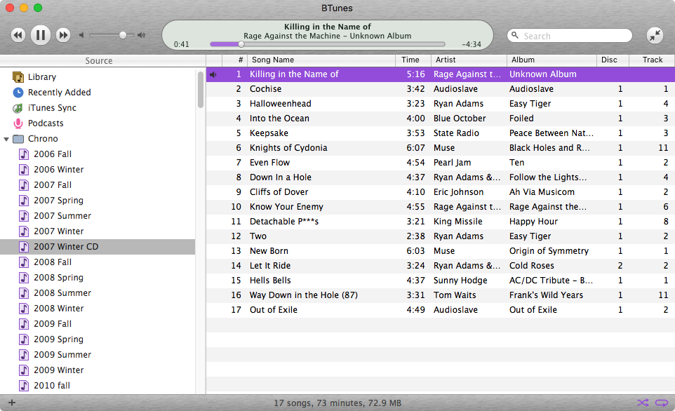
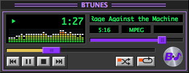

bTunes is a music player for the Mac that looks and works like iTunes circa early 2000s, with a Winamp-style mini mode.

bTunes is not affiliated with or endorsed by Apple, or by whoever owns Winamp these days.  iTunes is a trademark of Apple Inc. and Winamp is a trademark of its owner.  None of their code or artwork is in here.  This is a personal, non-commercial project.

**While bTunes can import (non-protected) music and playlists from iTunes, bTunes never writes to your audio files or to your iTunes library.**

## What this is and why it exists

My iTunes library goes back about 25 years and is primarily organized around playlists.  I can't get my playlists on Spotify, and fuck not owning your music.  One day, this Mac will die, or Apple will turn off its servers.  This has been a simmering problem for a decade.

My media center is a Mac old enough to have a driver's permit; El Capitan is the last OS it will run.

I want all my playlists and metadata from iTunes, with an interface from when iTunes didn't suck, and I want it to run on my media Mac.

## What it does

 - looks like iTunes 4: gray window, search top right, transport top left, readout in between, sources down the left
 - genre / artist / album browser columns across the top of the library
 - smart playlists, built from rules
 - playlist folders (which iTunes 4 didn't have)
 - imports from an iTunes library: songs, ratings, play counts, date added, and playlists
 - mini mode: a small dark panel with a spectrum analyzer that floats over everything, including full screen apps
 - a ten band equalizer
 - plays audio CDs, and rips them to AAC or Apple Lossless
 - burns a playlist to an audio CD, with CD-Text
 - syncs playlists to an iPod

## AI disclosure

A lot of the code in here was written with AI.  But it's taken months of refinement to make it feel awesome.

## Github

[Source code is here on github](https://github.com/brianssparetime/bTunes)
