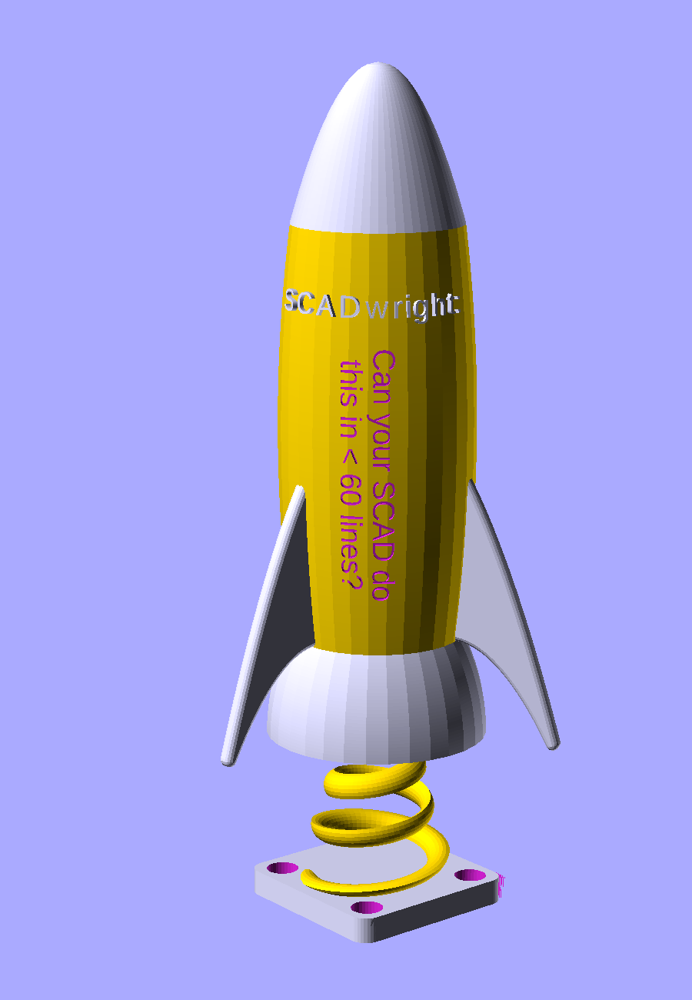

SCADwright is a Python library for designing 3D parts and assemblies: you write Python; SCADwright generates an OpenSCAD source file that renders into STL (or any other format OpenSCAD supports).

## What is this and why does it exist?

While OpenSCAD offers a straight-forward and easy path to programmatic 3d design, it is severely limited in ways that rapidly get annoying once your project grows beyond a few parts.

**SCADwright keeps the basic OpenSCAD model and primitives, but SCADwright goes way beyond just a python wrapper,  offering additional functionality not easily possible with OpenSCAD**:

 - [Components](https://github.com/brianssparetime/SCADwright#1-components-make-what-they-know-accessible-externally-modules-cant) written without boilerplate that can:
     - accept [any set of arguments](https://github.com/brianssparetime/SCADwright#2-define-a-components-equations-once-call-it-with-any-combination-of-sufficient-arguments-the-framework-handles-the-rest-no-boilerplate-components-are-as-nice-to-write-as-they-are-to-call) from which the rest can be calculated, using defined equations (rather than multiple definitions or complex conditional logic)
     - [enforce constraints](https://github.com/brianssparetime/SCADwright#2-define-a-components-equations-once-call-it-with-any-combination-of-sufficient-arguments-the-framework-handles-the-rest-no-boilerplate-components-are-as-nice-to-write-as-they-are-to-call) and validate arguments, also through the same equations
     - [expose attributes and calculations to other parts of the code](https://github.com/brianssparetime/SCADwright#1-components-make-what-they-know-accessible-externally-modules-cant) (as well as their bounding boxes and attachment points)
 - a library of [reusable shapes](https://github.com/brianssparetime/SCADwright#4-scadwrights-component-library-lets-you-focus-on-your-part-not-the-parts-its-made-of) out of the box
 - [auto-EPS adjustment](https://github.com/brianssparetime/SCADwright#3-no-more-eps-on-every-uniondiff-the-framework-handles-it) on difference() and union()
 - [surface-based attachment](https://github.com/brianssparetime/SCADwright#8-positioning-parts-relative-to-each-other-is-easy-without-extra-calculation), in a single chaining command
 - [placing text](https://github.com/brianssparetime/SCADwright#6-putting-text-on-a-plate-cylinder-cone-or-funnel-is-easy---one-operator) on geometric objects (plates, cylinders, cones) is easy
 - ability to [add new transforms](https://github.com/brianssparetime/SCADwright#5-scadwright-lets-you-build-reusable-transforms-in-addition-to-reusable-objects) to the language
 - [smart centering](https://github.com/brianssparetime/SCADwright#10-centering-components-is-easy-and-straightforward) built into new components by default
 - separate [print/display/integration/debug arrangements](https://github.com/brianssparetime/SCADwright#7-clean-separation-between-variants-for-printing-display-integration-testing-etc) of your part, with [one-line animations](https://github.com/brianssparetime/SCADwright/blob/master/docs/morph.md) between them
 - [python-style chaining](https://github.com/brianssparetime/SCADwright#11-transforms-chain-naturally-starting-with-the-object-being-affected) (e.g. `shape.linear_extrude(height=15).left(10)`, rather than OpenSCAD's transform-first and object-last notation)
 - scripts you can [parametrize from the command line](https://github.com/brianssparetime/SCADwright#13-scripts-can-declare-command-line-parameters-allowing-fully-programmatic-part-design) (including via json)
 - [real error messages](https://github.com/brianssparetime/SCADwright#12-error-types-and-messages-provide-detail-on-what-caused-the-error-and-where) with line numbers
 - [automated tests](https://github.com/brianssparetime/SCADwright#16-you-know-if-a-part-has-changed)
 - parts [know their own bounding box](https://github.com/brianssparetime/SCADwright#9-parts-know-their-bounds-without-needing-to-render-allowing-print-bed-tests-and-overlap-tests) without rendering — print-bed checks, overlap tests
 - `$fn` is [managed automatically](https://github.com/brianssparetime/SCADwright#14-resolution-fn-is-managed-for-you-but-easily-overridable), but easy to override
 - [manufacturing fudges](https://github.com/brianssparetime/SCADwright#15-manufacturing-specific-fudges-are-easy-to-add-track-and-keep-separate-from-design-considerations) (extra clearances, material variance) are tunable, without interfering with finished-part design dimensions (or parts that reference them)

 and more.

While simple projects very strongly resemble OpenSCAD code (easy to be productive immediately), as your projects grow in complexity, **SCADwright allows a graceful transition to more complex features**, without any hard syntactic or conceptual boundaries. **Styles can be mixed and matched in the same project.**

I have put significant effort into refining the UX of SCADwright:  the more advanced constructs use a syntax that's neither OpenSCAD nor quite standard object-oriented python. Instead, the goal is to **ruthlessly eliminate boiler plate,** and make constructs **simple, elegant, and highly expressive**. 

SCADwright optimizes for common cases, for those with little background in object-oriented python or advanced OpenSCAD, but retains full python capabilities and a low-level interface for exceptional cases.

SCADwright calls OpenSCAD only at render time. The Python side requires `sympy` (pulled in automatically by pip) and nothing else.  I've taken some care to make emitted SCAD human-readable.

If you're comparing SCADwright against SolidPython, PythonSCAD, CadQuery, Build123d, or other Python+CAD tools, see [How is SCADwright different?](https://github.com/brianssparetime/SCADwright/blob/master/docs/how_is_scadwright_different.md) for a side-by-side.

At this point, most of the flaws with SCADwright are in the SCAD part - OpenSCAD has some serious in-built limitations and quirks.  Although SCADwright is great for evolving beginner projects into medium ones, and large projects are stil far less of a nightmare than OpenSCAD, I can already see a better tool.  Fortunately, I wrote SCADwright so that I could substitute a different back-end in the future - if development continues, that will likely be the approach for a SCADwright2.

The [quick start / organizing a project guide](https://github.com/brianssparetime/SCADwright/blob/master/docs/organizing_a_project.md) is the best place to see the power of SCADwright in action, but there's also [full documentation](https://github.com/brianssparetime/SCADwright/blob/master/docs/README.md) and [examples projects](https://github.com/brianssparetime/SCADwright/blob/master/examples/README.md).

## A picture is worth 250+ lines of OpenSCAD

  

*[Less than 60 lines](https://github.com/brianssparetime/SCADwright/blob/master/examples/rocket.py) of SCADwright gives you: parabolic ogive nose, bulged body, three parabolic-swept fins with rounded edges, a flared nozzle, a tapered helicoid stem with an almond cross-section, a filleted M2-counterbored baseplate, and correctly spaced text (both raised and inset) on a doubly curved surface.*

## [SCADwright addresses 16 annoying limitations of OpenSCAD](https://github.com/brianssparetime/SCADwright#scadwright-addresses-16-annoying-limitations-of-openscad):

1. Components make what they know accessible externally; modules can't.
2. Define a component's equations once, call it with any combination of sufficient arguments, the framework handles the rest; no boilerplate. Components are as nice to write as they are to call.
3. No more EPS on every union/diff; the framework handles it
4. SCADwright's Component library lets you focus on your part, not the parts it's made of
5. SCADwright lets you build reusable transforms in addition to reusable objects
6. Putting text on a plate, cylinder, cone, or funnel is easy - one operator
7. Clean separation between variants for printing, display, integration testing, etc.
8. Attaching shapes, components, or parts to each other is easy, without extra offset calculation
9. Parts know their bounds without needing to render, allowing print-bed tests and overlap tests
10. Centering Components is easy and straightforward
11. Transforms chain naturally, starting with the object being affected
12. Error types and messages provide detail on what caused the error and where
13. Scripts can declare command-line parameters, allowing fully programmatic part design
14. Resolution ($fn) is managed for you, but easily overridable
15. Manufacturing-specific fudges are easy to add, track, and keep separate from design considerations
16. You know if a part has changed

## Dependencies

SCADwright requires `sympy`, `pygls`, `freetype-py` and nothing else.

## Editor integration

If you try hard enough to eliminate boiler plate, sooner or later you wind up with a DSL (design-specific language) (or you reinvent a worse form of LISP).  While it's tempting to embrace that in an ecstatic frenzy of ascetic pursuit, the hangover is a total lack of IDE support for your weird syntax.  The world, it seems, does not appreciate beauty.

So I wrote us a Language Server Protocol (LSP).

This project also includes [VSCode](https://github.com/brianssparetime/SCADwright/tree/master/vscode/) and [PyCharm](https://github.com/brianssparetime/SCADwright/tree/master/pycharm/) extensions.

## SCADwright and modeling with AI

Compared to OpenSCAD, building a model with AI in SCADwright (and the MCP below) is faster and lets you take bigger steps than just building in OpenSCAD directly.

Claude Code summarized the key benefits of its working in SCADwright over OpenSCAD as:

 - equations and constraints catch a lot of lazy or under-specified mistakes with explicit errors - ones that, in OpenSCAD, might otherwise might result in a less scrutable error or slip through entirely 
 - higher level abstractions (like `attach(fuse=True)`, `through()`, custom transforms, `add_text()`, etc.) are closer to what the user describes and require less interpretation/translation into code
 - AI is much better writing at python than openscad, reflecting the relative frequency of python in training data 

Whichever AI assistant you use, dropping the [style guide](https://github.com/brianssparetime/SCADwright/blob/master/docs/style-guide.md) into its context steers generated code away from generic-Python habits toward SCADwright's idioms.

### MCP

If you're developing with Claude Code, install the [OpenSCAD MCP server](https://github.com/quellant/openscad-mcp). It gives Claude the ability to render your `.scad` output, visually inspect the result, and catch geometry errors without you having to open OpenSCAD yourself. SCADwright's generated SCAD is fully compatible — Claude can build your script, render it through the MCP, and iterate on the design in a tight feedback loop.

## Is this AI generated slop?

I've been working on the specification for this for years, long before vibe-coding was a thing.

Is there AI generated code in here?  Yes.  It's 2026 and I have a job.  Sometimes a life too.  

Is this one-shot-slop?  No.  It's the result of hundreds, maybe thousands, of incremental iterations, and a fair amount of hand-coding and human-writing (including this whole page here).

Pretty much every part of SCADwright has gone through at least 5-6 major revisions, reducing duplicate and boilerplate code, making the constructs intuitive and naively simple, and working through hard framework trade-offs, in detail through examples.  I've been writing code longer than Python has been a language (and I've been writing serious code longer than Python has been a serious language) - I wouldn't put my name on something that's dogshit or poorly thought out.   Hell, I even went to the effort to make the emitted SCAD human-readable.

In parallel, I'm actually using this framework for my current 3d printing projects: the [Bronica S2 lens housing](https://github.com/brianssparetime/SCADwright/blob/master/examples/simple-lens-housing.py) and [convex lens caliper attachment](https://github.com/brianssparetime/SCADwright/blob/master/examples/convex-caliper.py) both leverage this 
framework and motivated its completion.

## Functional Programming

I'm sure someone will accuse this project of pissing all over OpenSCAD's functional programming purity.  

On the one hand, OpenSCAD isn't pure to begin with (Haskell syntax, but where's the type system and typeclasses?).  On the other hand, SCADwright's equations syntax is pretty fucking FP (at least in the ways that FP isn't annoying).

At bottom, I'm far more interested in making SCADwright easy and widely usable than I am in expanding your consciousness through FP indoctrination.  

## Documentation

I've taken great care to produce excellent documentation that's easy to consume.  This is not an AI-generated afterthought, but rather carefully written docs for producing expressive and powerful code simply.

[Full documentation here](https://github.com/brianssparetime/SCADwright/blob/master/docs/README.md). Documentation is along the lines of the [OpenSCAD Language Reference](https://openscad.org/documentation.html).  There's also a [cheatsheet](https://github.com/brianssparetime/SCADwright/blob/master/docs/cheatsheet.md) that parallels [the OpenSCAD cheatsheet](https://openscad.org/cheatsheet/).

For a quick intro, see [How to organize a project](https://github.com/brianssparetime/SCADwright/blob/master/docs/organizing_a_project.md).

This framework also includes [examples of projects at various levels of difficulty](https://github.com/brianssparetime/SCADwright/blob/master/examples/README.md).

If you're comparing SCADwright against SolidPython, PythonSCAD, CadQuery, Build123d, or other Python+CAD tools, see [How is SCADwright different?](https://github.com/brianssparetime/SCADwright/blob/master/docs/how_is_scadwright_different.md) for a side-by-side.
