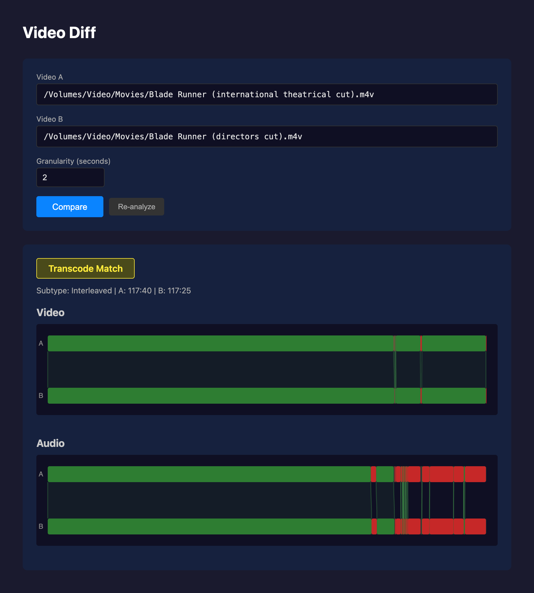
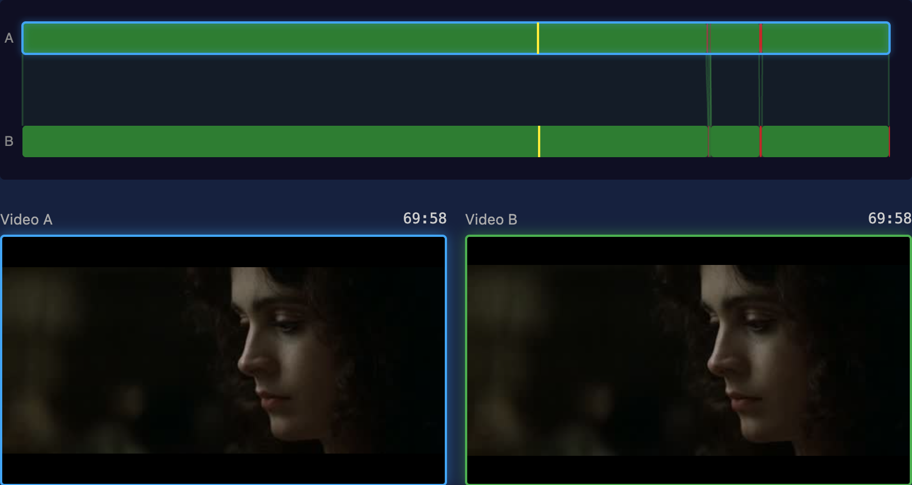
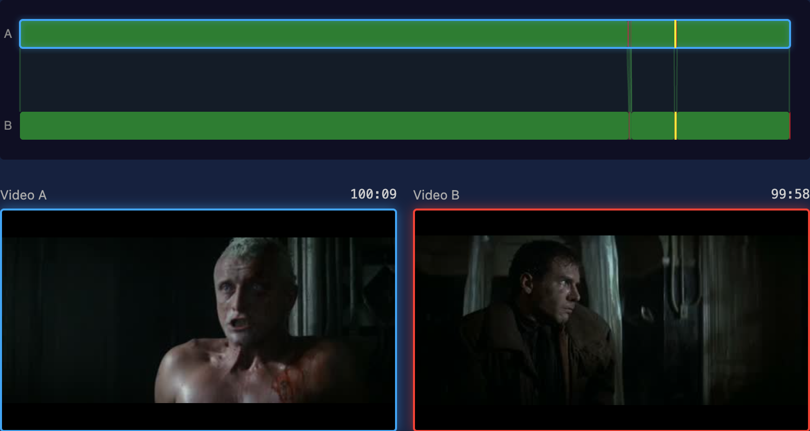

videodiff is a visual `diff` for video files.

videodiff compares the video content of two files by matching video frames and audio, so changes in resolution or container don't interfere with the compare.

Like the standard diff tool, you can easily see which blocks of video and audio are shared, A-only, or B-only, with time ranges in both files, making it easy to find deleted or added scenes.  Video and audio are scored separately, so a film with the original picture and a dubbed soundtrack matches on video and diverges on audio.

The UI allows you to scrub or play through either file, so you can see the divergence or convergence.

The comparison above is the international theatrical cut of Blade Runner (A) against the director's cut (B). The picture matches for the first 92 minutes, then shared and unique spans alternate through the ending. The audio bars diverge earlier and more often, because the two cuts share picture over spans where their soundtracks differ.

## videodiff also outputs a report

- **Match type**: byte-identical, a transcode of the same content, or no match.
- **Relationship**: the two files are the same throughout (straight), one is wholly contained in the other (subset), or shared and unique spans alternate (interleaved).
- **Segments**: the time ranges, in each file, where content is shared or unique.
- **Rate shift**: a constant speed difference between the two, such as the 4 percent PAL speedup, reported as a single rate factor.

## Web UI

The web interface lets you select two files to compare with a scrub viewer.

Two bars appear, one per file, green where they share content and red where they don't, dimmed for divergences under about five seconds. Ribbons connect the matched spans across the two bars. Audio is drawn the same way below.

Scrubbing a bar decodes the actual frame at that timestamp and shows it beside its counterpart in the other file, located through the computed mapping. Nothing is smoothed or approximated. If two frames that should line up don't, the mapping is wrong.

Clicking a bar locks the viewer at that point. Here the A bar is locked at 69:58, inside a shared span, and the green outline on B marks the matching frame in the other cut.

At 100:09 the theatrical cut is inside a span the director's cut lacks. B has no counterpart, so it shows the frame at the same offset from the last shared span, outlined in red.

## Methodology

videodiff works in three basic stages:

**Fingerprinting.** A transcode changes every pixel, so videodiff reduces each video to eight signals instead, sampled four times a second. ffmpeg decodes sequentially, and each sampled frame yields brightness, contrast, edge strength, saturation, two coarse spatial-layout hashes, and hue stored as a sine and a cosine so that it wraps cleanly at red. Audio goes through fpcalc for Chromaprint fingerprints, chunked at the chosen granularity. Fingerprints cache to `/tmp/videodiff_cache`, keyed by the file's content hash and the granularity, so a repeat comparison reuses them instead of decoding the files again.

**Alignment.** Absolute values drift under transcoding, since the whole picture comes out a little brighter or a little flatter. Alignment works on the normalized first derivative of each signal instead. Taking the derivative discards a constant brightness offset, and normalizing discards the gain, which is most of what a transcode changes. Cross-correlating the derivatives gives the offset that best lines the two files up, and from there the aligner walks forward, confirming window by window. It searches both directions and merges the results, because a single forward pass skips matches. A linear fit across the matched offsets catches a rate shift; when one turns up, videodiff resamples B onto A's timeline and runs the whole search again, keeping that result only if it scores better.

**Classification.** A correlation window slides along each long match, and where the best local offset jumps, the match splits, because cutting a few seconds out of one file moves everything after the cut by that much. A binary search then pins each boundary between a shared span and a unique one to the point where match quality drops, within one granularity step. Whatever gaps remain become the A-only and B-only segments. Audio goes last, compared inside each shared video span by Hamming distance over the fingerprint chunks.

## Github

[Source code is here on github](https://github.com/brianssparetime/video-diff)
