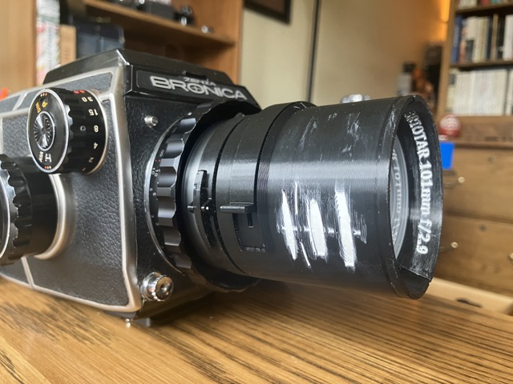
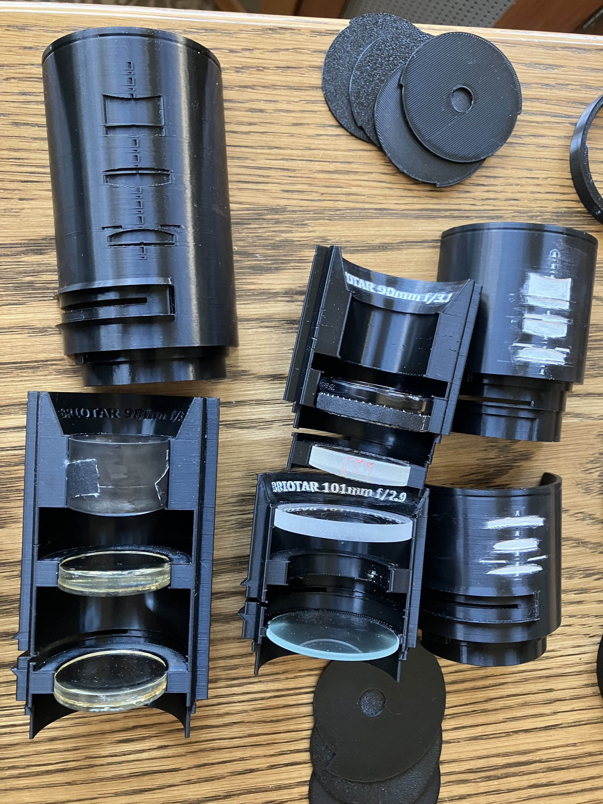
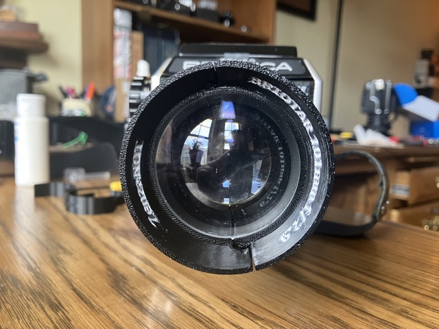
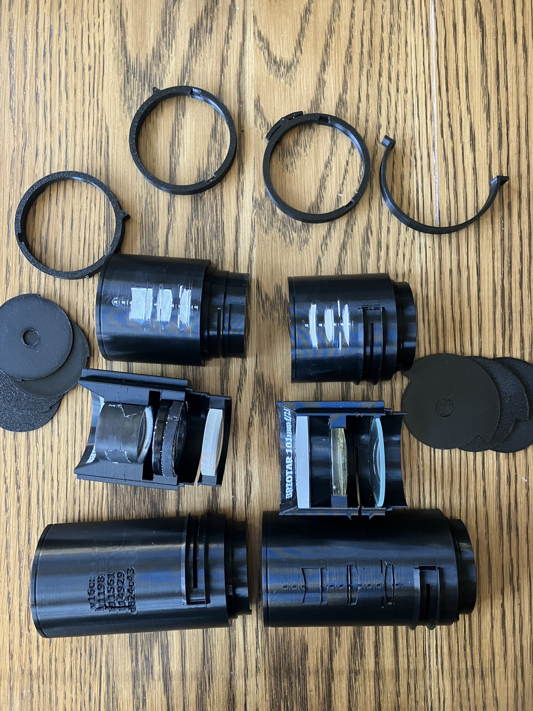

This post covers the 3d printed lens housing, the new SCAD language I built to engineer it ([SCADwright](https://github.com/brianssparetime/SCADwright)), and some bonus stuff I built along the way.  [Part 1](/posts/zenzanot-1-lens/) covers the final lenses; [Part 3](/posts/zenzanot-3-process/) covers the design process; [Part 4](/posts/zenzanot-4-swirl/) covers what I've learned about producing swirl in optical designs.

## Project goal recap

My goal was to create an art-bokeh, ~100mm ~f/2.8 lens for the Bronica S2, using only $5-7 elements bought from [SurplusShed](https://www.surplusshed.com/search_lenses.php) using 1930s formulas instead of raytracing.

In the unlikely event it's not obvious, I have no particular background in optics or lens design.  I am a competent software engineer (though not as a profession), and very good at smelling bullshit.  I'm also patient.

## Lens housing goals

A good lens optical design isn't much good if you can't hold the elements precisely.  The space between elements needs to be right, the elements all need to stay centered along the optical axis, and they all need to be square to it.

### First attempt

On [my first attempt](/posts/my-first-attempt-at-designing-and-building-a-lens-from-scratch/), the lens housing was primitive, slapped together in OpenSCAD by hand.

The housing consisted of a main tube with built-in rear retaining ring.  Spacing was done by dropping in the back element, then a spacer tube, a stop disc, another spacer tube, and then the front element.  A front bezel snapped in to retain the stack from the front.   Elements constantly rattled, and the constant-width tube and spacers did little to ensure elements were actually perpendicular to the path of light.

Mounting was via friction fit into a [RAFCamera M47 to M42 adapter ring](https://rafcamera.com/adapter-m42x1f-to-m57x1m).  It was sketchy.

### Second attempt goals for the housing

I had a lot of things I wanted to improve:

- real mount via the bayonet, no adapter needed
   - with latching
- can change the aperture without full disassembly
- more accurate axial spacing
- tighter grip on elements to keep them centered and perpendicular to the light
- and most importantly, a design that's relatively independent from the optical design, so if I iterate on the optics, I'm not starting over on the housing

The new housing addresses nearly all of these concerns.

But getting there wasn't easy....

## A better way to do CAD

From the first attempt at a lens housing, I knew I was close to the limits of OpenSCAD - not so much in terms of technical features, but in terms of project management.  OpenSCAD's building block modules cannot share attributes, or read from other modules.  As a result, you either have LOTS of really-long-name-constants, or you engage in fragile and extensive shenanigans to circumvent this, so that parts can mate without duplicated dimensions.

Since then, I'd been sketching out ideas for what I really wanted from an OpenSCAD wrapper:

  - modules that share attributes, or read from some kind of inherited specification
  - the ability to specify different sets of arguments for modules without having tons of conditionals or multiple definitions
  - auto management of eps and fn
  - better text handling
  - error messages that don't suck donkey balls
  - and like 10 other things that annoyed me

So in parallel to building the lens housing, I built my ideal OpenSCAD emitter ([SCADwright](https://github.com/brianssparetime/SCADwright)).  It's now FAR more than just a wrapper, with new high-level constructs that address all the shortcomings I had with OpenSCAD.  [SCADwright is everything you wished OpenSCAD could be](https://github.com/brianssparetime/SCADwright).  And it's not AI slop either.  I've worked on it for months, extensively refactored its core and feature set, and word-smithed the documentation.  The provided examples are real things that work, and which seem magical compared to their OpenSCAD equivalents.  I've used it on half a dozen other projects since too.

Out of the time I've spent on this whole swirly lens project over the last 9 months, a bit more than half of the total time has gone into SCADwright.

Interestingly, creating the high level abstractions I wanted, combined with an existing MCP for OpenSCAD, made AI-driven 3d modeling of the lens housing reasonably efficient.  Armed with ever-more-powerful and evolving versions of SCADwright, I now had the tool I needed to build my housing.

## The final lens housing 

In contrast to the "muzzle-loader" of v1, this design is split down the optical axis into two halves that snap together.  The locking mount ring then snaps on, adding an extra layer of security, and keeping supports minimal and easily extractable.  The aperture slot has a snap on cover.  The lens hood draws its angle from the optical plan's field of view.

Key features:

- the mounting ring matches the geometry of both my S2 and EC-TL helicoids (yes they are subtly different)
   - mounting ring has a lever-with-tooth style latch.  Making a torsion spring for it from spring steel wire though is surprisingly difficult; I have not fully solved this yet
- the mount ring snap fits to the two housing halves via a ring/groove with two alignment tabs to keep it angularly aligned
- the two halves have a snap-fit light-tight seam, designed as a reusable transform
- the housing is built from a json file containing the lens element names and dimensions, element and stop spacing, focal length, max aperture, field of view, etc, and generates all geometry based on that
- STRONG constraints so that designs that aren't manufacturable fail fast
- apertures are waterhouse stop discs, half sized for the housing's inner diameter, and half sized for the outer.  This way they are easily swappable, and covered by a slot cover if outside the mount
- text on the front bezel and lens hood
- text on one side of the housing for the version #, lens element codes used, and the github hash of the most recent commit
- the other side has an engraving of the optical plan (generated by the optical toolkit, at least somewhat based on real measurements and element types)
- rapid-iteration fit testers:
   - element gripper ring halves for testing thickness and diameter
   - mount axial fit slice tester for checking lug axial placement
   - open ring tester for checking radial fit
   - helicoid internal clearance tester that defines/demonstrates the maximum allowable diameter inside the flange, as a function of depth and angle

I have roughly one cubic foot's volume of failed and fucked up prints I've accumulated along the way.

I know someone's going to point out the lack of lens baffles and all the smooth, reflective surfaces.  I didn't want to bother with that complexity until I'd otherwise solved most of the problems, and at this point, I don't really care to.  If I revisit this in the future with a non-art lens that would actually benefit significantly, I probably will add that feature.

## Key insight on testing/iteration

I spent WAY too much time printing full articles when I should have taken the time to think about smaller testers.  For example, printing the full mount ring made it hard to see how far off my lug grooves were in terms of how deep they are or how far away from the flange they're located.  I wasted a lot of filament before realizing that a lot of small, specific test articles that only check one dimension of a fit each is faster than a guess/check/hope loop on the final product.

This design evolved slowly, rather than springing fully-formed from my head like Athena.  Months of testing solved problems, created new ones, and solved those.  Good engineering takes time.

SCADwright's constraint system and error messages are a huge boost to AI productivity.  At all levels, I tried (with varying levels of success) to make tools that either work as expected or fail cleanly and specifically, and to avoid the pitfall of "working" in a formalistic sense but producing unintuitive garbage (which OpenSCAD is happy to do).  This is not easy, and I'm sure there's more work to be done.

But when done right, simply running the model's python script produces error output sufficient for the AI to understand a lot of problems.

## Github

If you want to try SCADwright (alone or with AI) for your next project, you can find it [here](https://github.com/brianssparetime/SCADwright).

The lens housing project has its own github repo [here](https://github.com/brianssparetime/bronica-lens-housing).

## Bonus

As part of this project, I wound up making a few other useful things:

### Bronica S2 body and rear-lens caps

SCADwright is a python package that makes writing OpenSCAD for 3d models easy, manageable, and tunable.  But if you just want the STL, links below as well.

- S2 rear lens cap:  [SCADwright](https://github.com/brianssparetime/bronica-lens-housing/blob/master/rear_lens_cap.py) / [STL](https://github.com/brianssparetime/bronica-lens-housing/blob/master/releases/caps/rear_lens_cap-rear_cap.stl) ([symmetric lugs](https://github.com/brianssparetime/bronica-lens-housing/blob/master/releases/caps/rear_lens_cap-rear_cap_sym.stl))
- S2 helicoid body cap:  [SCADwright](https://github.com/brianssparetime/bronica-lens-housing/blob/master/body_cap.py) / [STL](https://github.com/brianssparetime/bronica-lens-housing/blob/master/releases/caps/body_cap-cap.stl) ([with supports](https://github.com/brianssparetime/bronica-lens-housing/blob/master/releases/caps/body_cap-cap_print.stl))

### Pentacon Six body and lens caps

While I was working on the Bronica system in its own repo, I wanted an easy and simple example to illustrate SCADwright's abilities.  So you get Pentacon Six caps for free too.

- Pentacon Six rear lens cap:  [SCADwright](https://github.com/brianssparetime/SCADwright/blob/master/examples/pentacon-six-mount/rear_lens_cap.py) / [STL](https://github.com/brianssparetime/SCADwright/blob/master/examples/pentacon-six-mount/rear_lens_cap-cap.stl)
- Pentacon Six body cap:  [SCADwright](https://github.com/brianssparetime/SCADwright/blob/master/examples/pentacon-six-mount/body_cap.py) / [STL](https://github.com/brianssparetime/SCADwright/blob/master/examples/pentacon-six-mount/body_cap-cap.stl)
