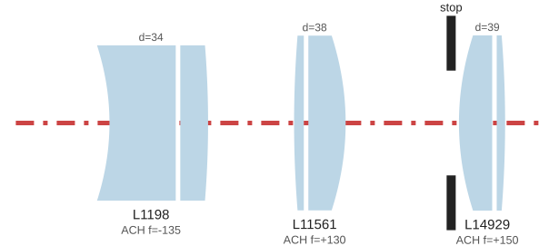

This post covers my lens design process.  [Part 1](/posts/zenzanot-1-lens/) covers the final lenses; [Part 2](/posts/zenzanot-2-housing/) covers the 3d printed lens housing, the new SCAD language I built to engineer it ([SCADwright](https://github.com/brianssparetime/SCADwright)), and some bonus stuff I built along the way; [Part 4](/posts/zenzanot-4-swirl/) covers what I've learned about producing swirl in optical designs.

## Goal recap

My goal was to create a swirly, ~100mm ~f/2.8 lens for the Bronica S2, using only $5-7 elements bought from [SurplusShed](https://www.surplusshed.com/search_lenses.php).

On [my first attempt](/posts/my-first-attempt-at-designing-and-building-a-lens-from-scratch/), I did all the design in Google Sheets using simple lens equations and some occasional consulting with AI.  I came up with a basic two element design, and tried to buy elements that approximately fit.

## Disclaimer

This is NOT a good way to make a lens.  I'm using 1930s optical formulas, and ignoring pretty much all modern ray-tracing abilities.  There are real, impassable limits to what can be modeled with this approach, leaving more to guesswork and trial/error than I would like.

Given those issues, why would anyone in their right mind do it?  Ray tracing requires reasonably precise measurements of the radius of curvature of each element face, and that in turn requires special equipment.

In retrospect, it would have been easier to build a radius measuring tool of my own and just write a ray tracer.  If I do a version 3 of this project, that will be my direction.

I have also taken little care to clean up the code here.  I realized pretty early on that this code has no future for me beyond the culmination of this project, and so my interest in making it beautiful was minimal.  It's good enough for my purposes here.

## Process

In contrast to my v1 attempt, I decided to treat the design as an **optimization problem over the lens elements I have, against an evolving specification describing my desired lens characteristics.**

First, I wrote clear design requirements, grouped by priority and reasonably quantitative.  Physical geometric limitations of the mount, recessed elements, and minimum element spacing were hard requirements.  After that, the rough goals of 100mm focal length and 2.8 aperture.  Finally the description of swirl.  All else equal, designs that are less sensitive to spacing errors in lens positioning are better.  All else equal, compact lenses are better.

Then, using Claude, I built the rest of the foundations:

- a database of the lens elements I have, and a database of potential designs (referencing the elements, but adding positions and the stop).
- an evaluator tool that holds my optical equations and estimates the properties of a given design
- a sweep tool that would plug in different designs to the evaluate tool
- a tool to let claude search surplus shed's lens finder, useful for discovering new elements
- documents for key design insights, and for cataloging generations of designs

Over the course of a few months, I iterated on improving the optical design, learning more about what makes swirl, buying more elements to unlock new designs, refining my understanding of the S2 geometry to make my design requirements stricter and more realistic, building and adding features to SCADwright, and improving the optical tooling to keep track with the rest.

I don't want to trivialize the importance of iteration - easily 95% of the work has been in months of gradual iteration, on top of a simple but clear initial foundation that took only a day or two.  Every advancement in any area unlocks possibilities in the others, and it takes a while to explore the space.

Each generation included a half dozen or more variations, trading off between adherence to focal length, aperture, swirl, flatness in the center, and overall size.  Seeing concrete options really helped me figure out what I prioritize, and to make the design reqs reflect that better for the next generation.

Spacing sensitivity, or the extent to which errors in the spacing between elements affect the optical properties, turned out to be a key insight.  Calculating the spacing sensitivity as part of the evaluation tool allowed me to include it as a low priority design goal, so my design would be minimally disrupted by any manufacturing deviations in the physical housing.

Challenges with the housing meant I had a lot of time to work on the optics;  physical testing only began around generations 12-13.

I added a few additional tools during that process:

- a comparison tool for looking at two designs side by side
- a spacing diagram tool to help with the lens housing
- an export tool for turning lens designs into json for the lens housing
- an optical plan diagram generator
- a helper tool for Claude to more easily search SurplusShed's inventory by focal length and diameter

After 16 generations, with the last one covering a search space of more than half a million possible designs, I have found my finalists, and decided to stop this insanity.

## AI insights

AI is very good at building tools, and running optimizations when given good tools and clear metrics for success.  

AI is decent at best, and most often poor, at optical engineering past the simple level.  But it's much better at doing research and writing python that encapsulates equations.

My hope was to leverage the strengths of AI by building the tools I needed to let the design fall out of them, and in this I think I was largely successful.

I don't want to give the impression that this was either painless, or magical and straight forward.  
 
It was none of those.  
 
More times than I can count, Claude confidently told me things that were straight up false, or got lazy and didn't actually do math.  Most of the key insights came not from Claude, but from me poking holes in Claude's reasoning, pointing out contradictions, and constantly asking for confirmation against web research. 

Vigorous and rigorous cross-examination is the best, and really only, way to be productive.  If you can bully your AI into flip flopping more than 2-3 times, you need to think harder, back up, and find some way to better ground the discussion in reality.

For example,  I pursued the idea of an image simulator for previewing swirl effects for some time, before realizing it was just an elaborate Potemkin village that Claude built for me.  Realistic simulation is just not pragmatic without surface radius measurements and ray tracing.  But walking down this path was a good lesson in exactly how far I could push this design process.

I am sure that at least some of the tools have bits that are bullshit.  For example, through many early generations, my swirl metric was somewhat bullshit - it roughly mapped to what I want, but ignored some potential contributing factors, while including "tie-dye" effects (where the bokeh smudge radially outwards rather than tangentially around the center).
 
But I've been pushing and testing on this for months, and the proof is in the pudding: my lens works well enough, given the severe constraints imposed on its design.

##  Github

I don't think these are footsteps worth following, but in the interests of transparency, [here's my project folder](https://github.com/brianssparetime/bronica_lens_design).

##  Lens Design Resources:

- [LensRentalBlog](https://www.lensrentals.com/blog/2011/08/lens-geneology-part-1) great for learning about basic designs without a ton of math (singlet, doublet, triplet, tessar, tele/retro, double gauss)
- [PencilOfRays](https://www.pencilofrays.com/lens-design-forms/) - this was interesting, but too advanced for me.  I didn't know a lot of the attributes of my budget lenses which I needed to fill out the spreadsheet
- formulas for lens combination and bfd [here](https://jackwestin.com/resources/mcat-content/geometrical-optics/combination-of-lenses) and [here](https://physics.stackexchange.com/questions/800901/geometric-optics-multiple-lens-focal-length-calculation)
- [Optical aberrations explained](https://www.eckop.com/resources/optics/aberrations/)
- [lensmaker's equation on wikipedia](https://en.wikipedia.org/wiki/Lens#Lensmaker%27s_equation)
- [M57 adapters for Bronica from RAF camera](https://rafcamera.com/searchanise/result?q=bronica%20m57) 

