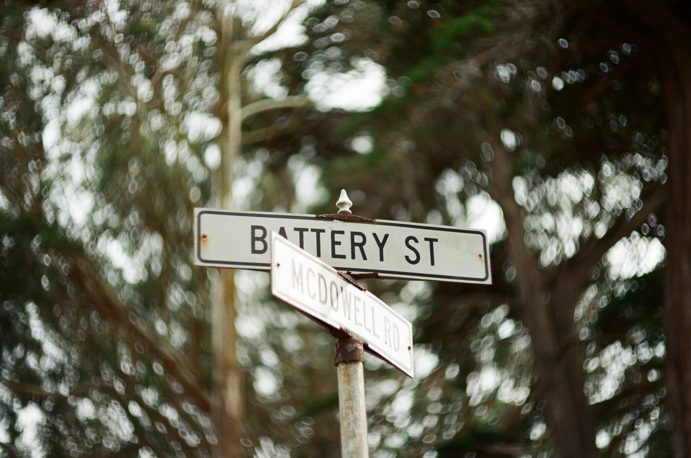
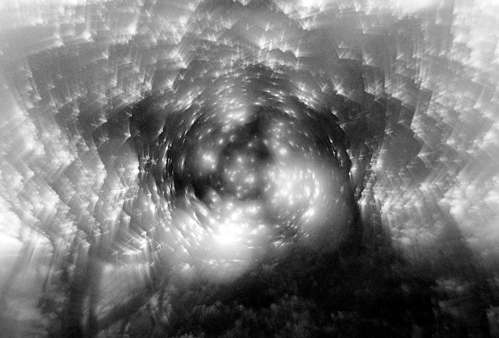
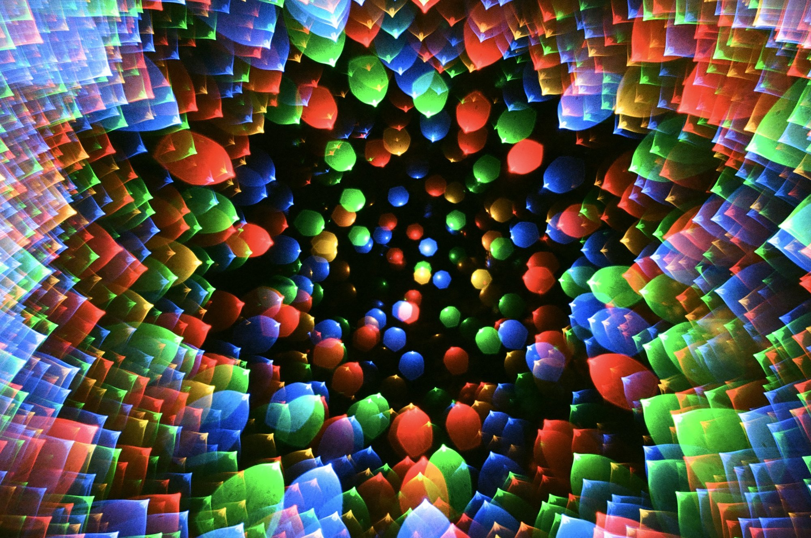
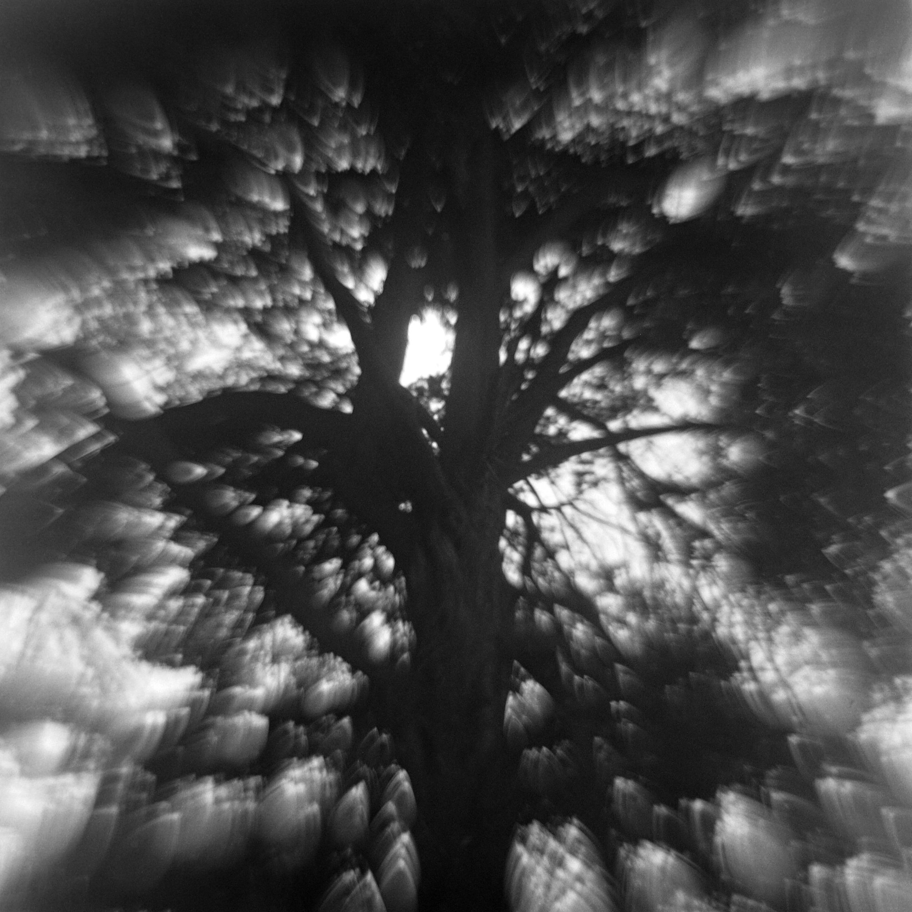
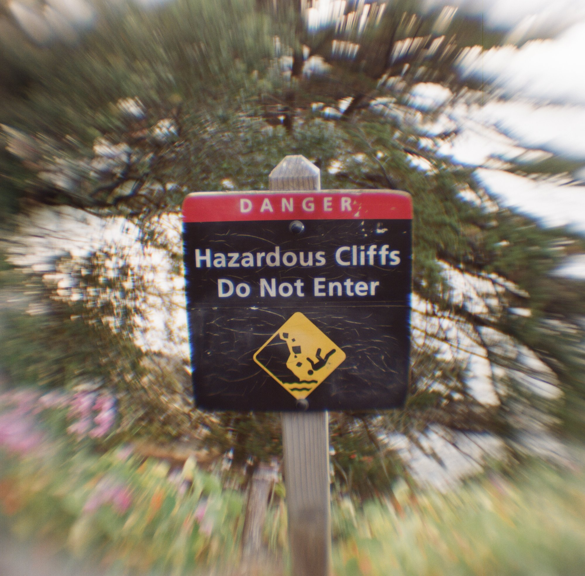
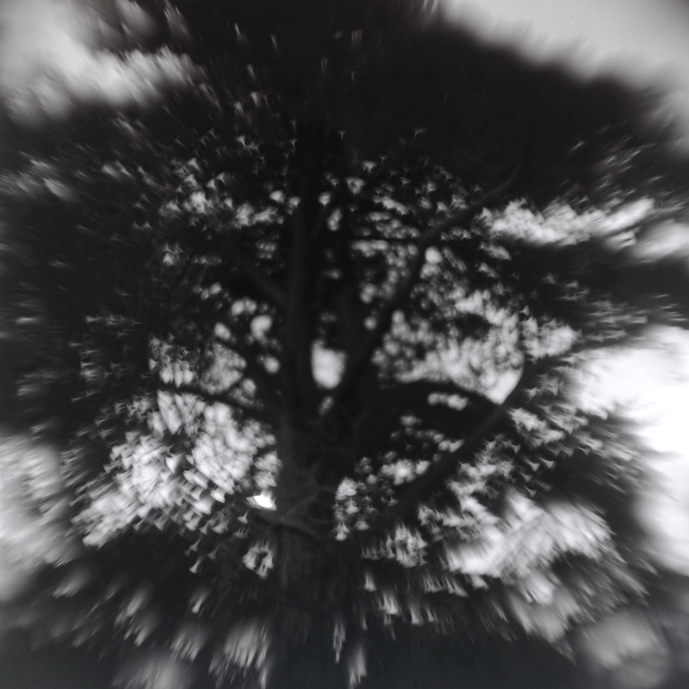

The state of swirl science on the internet today resembles closely the comments of US Supreme Court Justice Potter Stewart on the topic of obscenity:  "I can't define it, but I know it when I see it."

A more precise definition is easy to provide; one that is understandable by those without a PhD in optical engineering is much more challenging.  

In this post, I aim to do that: explain in plain, understandable terms 1) what swirl actually is, and 2) what optical properties of a lens contribute to it, by how much.

I have no particular training or education in optical engineering, [other than the last year I've spent designing my own lenses using 1930s-era optical formulas.](/posts/zenzanot-1-lens/).  I have used AI to write programs that handle the optical calculations, and to help me understand the way different variables affect each other, but the writing and explanation here are mine and all this is supported by the three lenses I designed and built.  I have made some simplifications in writing this, especially as regards sagittal rays, to try to keep it understandable.   And I'm sure some stuff is wrong - I welcome any corrections.  

## Constraints

Of course, I am not designing first and foremost for swirl.  Unless you are bonkers, swirl comes only after:

- physical constraints of back clearance (the lens can't hit your mirror) and diameter (can't have an element that would overlap with the mount's flange or that doesn't fit in the camera)

- focal length - usually you have at least a ballpark idea that constrains the optical system

Some of the levers for swirl discussed below also affect these, and thus aren't fully freely tunable without potentially undesirable side effects.

## Swirl

Swirl happens when the out-of-focus light points (bokeh) in an image distort from a circular shape into a shape that is compressed along an axis towards the center but elongated on the perpendicular axis (the axis tangential to the center).

The cumulative effect of every point being smeared tangentially yields the classic impression of circular motion. 

Two optical properties primarily determine swirl:  astigmatism, and field curvature.  A third, coma, doesn't create swirl but can cancel it.  I'll explain all three in more detail below, but in short:

Astigmatism is the difference in how a lens focuses light on two axes, and it controls which direction the blur runs.  

Field curvature is the shape of the field of focus.  

Field curvature is important for swirl because, for a given composition, it increases the likelihood that the corners and edges will be defocused relative to the subject, allowing the distorted bokeh to appear.

Other considerations matter only to the extent that they influence these factors.

## Astigmatism sets the direction

To borrow from Wikipedia, if you took an image of a cross shape through a lens with strong astigmatism, the horizontal and vertical bars of the cross would be in focus at different distances.

Astigmatism is formed when a lens does not balance the focus point for light coming in at different angles.  Lines running radially from the center focus at a different distance than do lines running around it (tangential lines).

(Textbooks call the radial one "sagittal."  I'm going to try not to use that word.  Like a chimp with a stick, I understand it well enough to use it, but not well enough to teach the tribe.)

This difference transforms off-center points from round blurs into directional, oriented streaks or smears. The smear grows with distance off-axis, which puts the strongest effect in the corners.

The direction a point smears depends on whether radial or tangential line focuses closer to the film plane.  

If the film is closer to the depth that sharpens the tangential lines (the ones running around the center), the corners smear into arcs around the center, giving you classic swirl.  But if the film is closer to the depth that sharpens the radial spokes, they smear radially away from the center (I call this "tie-dye" because the bokeh seem to rush centrifugally outwards).  If the film is balanced between the two, the blur stays round.

Thus the type of blur flips between the out-of-focus foreground, and the out-of-focus background (assuming you are focused to a mid length).  But, to be clear, here I'm discussing swirl as a background effect, even though the same lens may tie-dye when the bokeh generating points of light are between the lens and the focus plane.

Astigmatism is a tug-of-war between the elements, with three factors primarily determining the outcome:
  
- An element's power sets its pull and the direction of that pull. Left to itself, a positive element pulls the background smear radial (tie-dye), and a negative element pulls it tangential (swirl). The stronger the element, the harder it pulls. This is why a lone positive lens, like a magnifying glass or a box camera lens, tie-dyes a distant background instead of swirling it, and why I've come to believe a swirly lens needs a negative element doing real work somewhere.

- The shape of an element can change its pull without changing its power, so two elements with the same focal length can still have opposite pulls. Shape and stop placement can even override the default, though. The classic Petzval portrait lens is nearly all positive power, yet its rear group is bent and placed so the tangential focus gets pushed outward, which is what makes it swirl.

- Where the light crosses each element matters about as much as the element itself. Light from the edge of the frame hits each element off-center, and the further off-center it hits, the more that element splits the focus (it goes as the square of the distance). Wider spacing is an easy way to push that light further off-center on the next element. Stop position and element order do it too, and I'll get to those below.

## Field curvature gets the corners out of focus

Unless it's engineered otherwise, a lens does not come with a flat field of focus.  Left to simple
physics, a lens focuses the world onto a shallow bowl instead of a plane. Designers flatten that
bowl on purpose, with extra elements and careful glass, and a good modern lens flattens it
almost completely. Simpler and older designs never did, and a few early cameras gave up and just curved
the film itself to sit in the shape of the bowl.

The depth of that bowl is the Petzval sum.  The Petzval sum has one term for each element (roughly 1 / (glass index * focal length)), and its total predicts how steeply the field curves.  More on glass index in a moment. 

Strong positive elements and weak negatives drive it up to produce a deeper bowl, and a stronger pull toward swirl.  A steep bowl drops the corners out of focus more aggressively, leaving plenty of blur for astigmatism to work on.

Note:  the thin depth-of-field from a wide or wide open aperture accentuates the effect of field curvature, since the thinner DOF applies across the whole field.

## Controlling field curvature

### Bowl shape
Beyond just its depth, optical design can affect how steeply the walls of the bowl curve at different distances from its center.  The curvature can concentrate mostly out at the edges while the center stays nearly flat, or it can be more evenly distributed across the whole field.

But unless you are solely interested in the abstract, a flat center is important for having a reasonably sharp subject in focus.  

Luckily, astigmatism can flatten the bowl by pushing the tangential focus back out toward the film while the radial focus follows the bowl inward, and which also (recall from above) produces swirl as a side effect.  I think Old Petzval portrait lens did this on purpose, but to achieve the flatness at the cost of swirl, rather than the other way around.

Two cautions.  A flat center is not sufficient to make a sharp center.  Spherical aberration can make a lens soft on axis no matter how flat its field is.  And merely getting the direction right doesn't necessarily make the swirl strong (a Tessar has the same sign of astigmatism at the edge and barely swirls, because its bowl is shallow).  The real tradeoff is depth of bowl against width of flat center.

### Element Powers

The division of negative power across elements affects the bowl's shape. 

While the Petzval sum counts only the total depth, but this doesn't account for the shape fully.   Two lenses with the same negative power will have the same depth, but whether the power comes from one strong negative or several equivalent weak ones (that sum to the strong one) will cause the edge curl to differ.

I think a single strong negative bends the edge rays harder than the same power spread across gentle elements, so the field falls off faster near the corner than the smooth bowl the Petzval sum predicts. I think this is why conventional designers often avoided single strong elements (not to mention disadvantages with spherical aberration and coma).

I expected to exploit that by keeping the power concentrated. It did not work. My math can't model the edge curl, so I can't really confirm the effect, and v13f (built around a single strong negative) tie-dyed instead of swirling because of the coma (see below). The later, actually-swirly, lenses all used a gentler negative in a cemented doublet.   

At any rate, once the negative is strong enough to set the swirl direction, anything beyond that costs you swirl by flattening the bowl (at least in my math; I haven't tested this fully).

### Glass type

Glass is the other lever on the depth of the bowl (as it appears in the per-element petzval terms of 1 / (glass index * focal length)). For a given focal length, low-index glass curves the field harder and high-index glass flattens it.

Optical engineers (who want a conventional lens) can match a high-index positive element with a low-index negative one to get their Petzval terms to cancel for a field flat.  While early lens designers didn't have high-refraction glass capable of this, anastigmats with this kind of glass have become the conventional solution to field curvature.

For our purposes, the goal and mechanisms are the opposite: To get the deepest bowl, we want low-index positives and high-index negatives to push the Petzval sum up, instead of cancelling it. 

I never got to use this lever.  Everything SurplusShed sells cheaply is ordinary crown glass at about the same index, and the achromats come as they are.  So this is theoretical, not something I tested, but I think it's pretty well-understood.

### Image circle and format 

Astigmatism and field curvature both build toward the edge of the field.  So whether you see any swirl from a given lens depends on how much of that field your film sees.

A lens projects a circle of image, with your film only seeing a rectangle in the middle of that circle, the way a proscenium frames the play and blocks the backstage.  If the rectangle only barely fills the circle, its corners sit out in the rough part of the field where the smearing lives.  But if you use a lens whose circle dwarfs your frame (one built for a bigger format than you're shooting), your frame sees only the quiet center.  That's how format can "change" the swirl - it's not really changing it, just looking at different parts.

When designing to promote swirl, you want image circle tight to the format for this reason.  If the image circle is too small, the circle starts to become visible in the corners as vignette (see below).

Absent a retrofocal design, shortening focal length shrinks the image circle, thus pushing the frame towards the outer swirl zone of the image circle.

## Aperture position

Sliding the aperture forward or back moves the astigmatism, which strengthens the smear, weakens it, or flips its direction.

On paper this is a clean lever: the focal length, back focus, and depth of the bowl are unaffected; only the astigmatism (and coma) change.  

In practice, aperture position is only secondarily useful.  If you want fancy bokeh, relying on fancy aperture placement means you're not shooting wide-open, which translates to much smaller bokeh artefacts.  I put the stop slot as close to the optimal place as the housing allowed (the optimal place was often underneath the ring that grips the S2's bayonet lugs where it would be impossible to change stop discs, so the slot had to go either ahead of, or behind the mount-zone), and hoped for the best.

However, even when wide open, some part of the lens design (usually an element) is the most constricted optically.  This element effectively becomes the aperture (and the basis for the calculation of f-number (focal length / entrance pupil diameter)).  But now your "effective" stop placement is tied to the position of that lens, which is complicated and yucky if you're also trying to use the stop for bokeh.  Moreover, with aperture governed by the diameter of that element,   increasing it means finding new glass, and decreasing it just sacrifices speed.

One more thing I didn't expect: on the lens with the three zones described below, stopping down to f4 pulled the flip inward, so more of the frame went to tie-dye, not less.  That's one roll from one lens, but it's the opposite of what I assumed.

## Element order and field curvature

The Petzval sum formula is insensitive to term order, so reordering the elements does not change the field curvature. 

But element order does affect astigmatism.  The same elements in a different order give off-axis light
different crossing heights, so we can keep the same bowl but independently can strengthen, weaken, or flip the direction of the smear.

Order also influences the back focal distance though, which is important since the lens has to clear the swinging mirror.  

## Coma 

Coma flares an off-axis point into a little comet, with a tail streaming out along the spoke, toward or away from the center. Like everything else here, the effect grows as you move towards the corners, and it grows as aperture opens up.

Coma competes with astigmatism for the direction of the blur. Astigmatism of the right sign pulls the corners tangential, coma always pulls them radial, and whichever is stronger wins. So the calculated astigmatism of a lens alone can't ensure swirl.

Unfortunately, the easiest ways to get swirl happen to also be the easy ways to get coma. Concentrating the power onto one or two strong elements produces the steep edge curl that swirls, and the coma comes along with it. The conventional fix, splitting those strong elements into gentler ones, softens the edge curl as well. So it's roughly a pick-two-of-three: a simple lens, one that swirls, and one with little coma. 

I think my poor understanding of this relationship is part of why my v13f lens exhibited such strong tie-dye. My calculations of the astigmatism indicated swirl and since I wasn't tracking coma correctly, I chose a single element as the negative element driving astigmatism.  But this also brought coma that overpowered the astigmatism, yielding tie-dye.

To fix that in subsequent designs, I used a cemented doublet achromat for the negative element instead of a single piece of glass, for the same negative power but much less coma.  Both swirl more than the earlier one, so I think this is the right approach (though it may be more complicated than just this).

## Unexpected additional bokeh regimes

My programs treat the frame as only two zones (a center area and periphery), but the test photos showed three distinct regions with different regimes (the sharp center, a swirl ring around the center, and tie-dye the periphery).

I don't think I can predict the flip in bokeh between the ring and periphery with 1930s math - it's coming from something higher-order.  I'm pretty sure that a longer focal length pushes it outwards (but flattening the bowl), and I think that a stronger astigmatism also pushes it outwards (but by how much I can't model).

## Focus distance

The ring of swirl only shows up when I focused close.  This is something to explore more in the future.

## Postscript: cat eye vignetting

Vignetting is a third cause of swirl, but unlike the other levers above, this has more to do with how the light path gets clipped by the housing, the stop, and the edges of the elements.

Vignetting affects swirl because, wide open, the off-axis light cone has to clear every opening in the lens in turn, and is chopped where it hits blockages.  Because those obstructions happen at different places along the path, the clips land offset, yielding a sliver between them as a cat eye shape.  (Stopping down, the stop becomes the single tightest opening from every angle, the rims don't clip at different depths, and so the corner highlights round out.)

A field of cat eyes creates a very similar swirl impression as the optics discussed above, but it can't do a tie-dye effect because every cat eye orients tangentially same way around the frame.

For this project, analyzing or taking advantage of this lever has been out of scope - it basically requires ray tracing and more detailed measurements of the elements than I'm capable of.  

I did succussfully predict the strength of the vignette on my last lens though.

